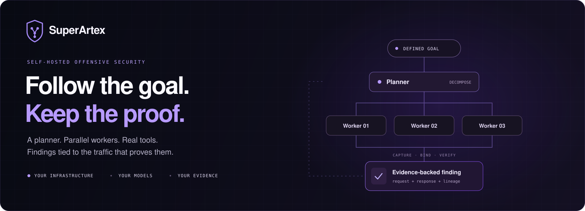
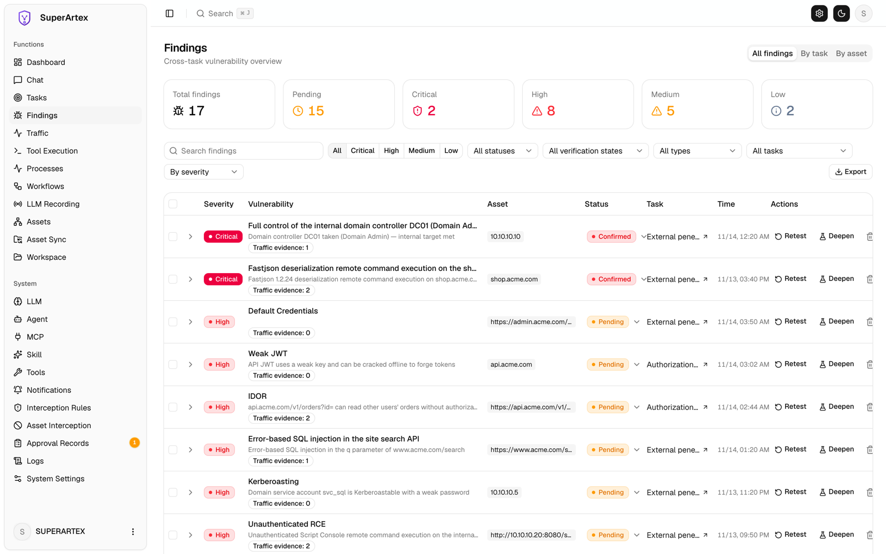
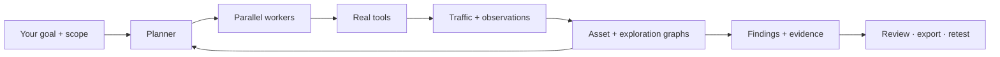

<div align="center">



# SuperArtex

**Autonomous penetration testing that keeps its receipts.**

Give it a goal and an authorized scope. A planner coordinates workers, workers run real tools,<br/>
and findings stay connected to the assets, commands, and HTTP traffic behind them.

[](LICENSE)
[](go.mod)
[](docs/getting-started.md)
[](docs/README.md)

[Quick start](#quick-start) &nbsp; / &nbsp; [Review results](docs/usage.md) &nbsp; / &nbsp; [Documentation](docs/README.md) &nbsp; / &nbsp; [Security model](docs/security-model.md)

</div>

---

## From a goal to a finding you can inspect

SuperArtex brings the assessment into one workspace: planning, tool execution, asset discovery, captured traffic, findings, and retests. Run it on your own infrastructure with an Anthropic, OpenAI-compatible, or local Ollama model.

<table>
<tr>
<td width="50%" valign="top">

### 01 · Plan with context

A planner breaks the goal into intents. Parallel workers test them, share observations, and write results into connected asset and exploration graphs.

</td>
<td width="50%" valign="top">

### 02 · Run real tools

Inspect execution history, tool results, and background job status from the UI.

</td>
</tr>
<tr>
<td width="50%" valign="top">

### 03 · Inspect the evidence

Connect findings to captured requests and responses. Follow their lineage, review proof, export reports, and launch a separate retest after a fix.

</td>
<td width="50%" valign="top">

### 04 · Stay in the loop

Configure approval rules, review pending decisions, and pause or steer tasks. Add skills, MCP tools, model profiles, and notifications as needed.

</td>
</tr>
</table>

> [!IMPORTANT]
> Use SuperArtex only on systems you own or are explicitly authorized to test. Task scope is advisory; scan jobs and workflows are outside the default approval-tool scope. Review the [security model](docs/security-model.md) before running an assessment.

## Quick start

You need **Git** and **Docker with Compose**. Compose builds the application from this checkout and starts PostgreSQL for you.

**1. Clone and configure**

```bash
git clone https://github.com/whyujjwal/superartex.git
cd superartex
cp .env.example .env
```

Edit `.env` and replace `POSTGRES_PASSWORD` with a strong password.

**2. Start the stack**

```bash
docker compose up -d --build
docker compose logs superartex | grep "Setup token"
```

**3. Claim your instance**

Open **[localhost:8787](http://localhost:8787)**. Enter the setup token from the logs and choose an administrator password of at least 12 characters. The login name is **`SUPERARTEX`**.

The first image build downloads the toolkit and may take a while. Both published ports are local to your host by default. For source builds or setup issues, see [Getting started](docs/getting-started.md).

## Inside the workspace

<p align="center">
  
  <br/>
  <sub><strong>Findings with context.</strong> Move from severity and asset to the evidence behind a result.</sub>
</p>

<table>
<tr>
<td width="50%" valign="top">

<p><strong>Review the decision.</strong><br/>See the call, the rule, and who approved it.</p>
</td>
<td width="50%" valign="top">

<p><strong>Read the receipt.</strong><br/>Inspect recorded requests and responses alongside your findings.</p>
</td>
</tr>
</table>

<details>
<summary><strong>Watch the animated product preview</strong></summary>

<p align="center">
  
</p>

</details>

<sub>Screenshots use the app's demo mode. The product preview uses fictional demo data; these are not results from a real engagement.</sub>

## Review and export results

Use the workspace to inspect recorded approvals, captured traffic, and findings. Review the evidence behind a finding before sharing its report.

**[Review and export existing results →](docs/usage.md)**

## Documentation

Start with [the documentation hub](docs/README.md), or jump straight to the task at hand:

- **[Getting started](docs/getting-started.md)** — Docker, first-run setup, and building from source.
- **[Review results](docs/usage.md)** — approval records, evidence, reports, and exports.
- **[Configuration](docs/configuration.md)** — database settings, ports, runtime files, and encryption keys.
- **[Toolkit](docs/toolkit.md)** — bundled capabilities and platform components.
- **[Operations](docs/operations.md)** — backups and restore, updates, reverse proxies, development, and troubleshooting.
- **[Architecture](docs/architecture.md)** — dual graphs, the planner/worker loop, and the codebase map.
- **[Security model](docs/security-model.md)** — approval coverage, target controls, evidence verification, and storage boundaries.

## Toolkit

The Docker image includes `nmap`, `nuclei`, `httpx`, `subfinder`, `katana`, `ffuf`, `dalfox`, `sqlmap`, `bbot`, and Playwright with Chromium, plus everyday shell utilities.

- **Skills** teach agents how to use a tool.
- **Typed scanners** translate structured inputs into argv and use a shared background runner with caching, concurrency caps, and a circuit breaker.
- **Workflows** chain scanner steps into repeatable runs.
- **Extensions** bring manually captured browser and Burp Suite traffic into the evidence store.

See the [toolkit reference](docs/toolkit.md) for the full inventory, default grants, and execution boundaries.

## How it works



The shared **asset graph** records what exists. Each task's **exploration graph** records what was tried and what it produced. Anchors connect the two, so a finding has both an affected asset and a traceable path through the assessment.

The application is a **Go service with an embedded Next.js UI**, backed by **PostgreSQL**. Read the [architecture guide](docs/architecture.md) for the engine loop and source layout.

## Installation

Docker Compose is the quickest path. For the interactive installer, native builds, Windows startup, and cross-platform archives, see [installation options](docs/getting-started.md#other-installation-options).

## Configuration

Use `.env` for Compose deployment settings. Configure the database with `config.json` or `SUPERARTEX_PG_DSN`. The [configuration guide](docs/configuration.md) explains precedence and runtime paths.

## Operations

Back up PostgreSQL, runtime data, and your actual encryption key directory together. The [operations guide](docs/operations.md) covers backup and restore, updates, HTTPS reverse proxies, and troubleshooting.

For a frontend-only preview:

```bash
cd web
npm ci
NEXT_PUBLIC_MOCK=1 npm run dev
```

Open the address printed by Next.js. Demo mode needs no backend or model key. See [development](docs/operations.md#development) for the full stack and checks.

## Security

Read [SECURITY.md](SECURITY.md) to report a vulnerability privately and the [security model](docs/security-model.md) to understand the execution paths. Approval rules cover a defined set of tools; task scope and request pacing do not provide an enforced network sandbox. Stored evidence headers are encrypted, while captured bodies are files on disk.

## Acknowledgements

SuperArtex is a **derivative work of [ARTEX](https://github.com/BaaRai/ARTEX)** (AGPL-3.0), originally authored by **Autumn-27**. The dual graphs, planner/worker engine, agent design, approval gate, and recording proxy come from upstream.

SuperArtex adds its branding, the background scan runner and Processes page, typed scan wrappers, workflows, the CTF solver agent, additional skills, Discord and Slack notifications, and the Burp Suite extension.

Thanks also to [`norma`](https://github.com/Autumn-27/norma), [ScopeSentry](https://github.com/Autumn-27/ScopeSentry), and [bbot](https://github.com/blacklanternsecurity/bbot). Individual playbooks keep their attribution in `skills/*/SKILL.md`.

## Authorized use only

> **SuperArtex is an offensive-security tool. Use it only against systems you own, or that you are explicitly authorized to test** — your own lab, your organization's assets, or a bug bounty / vulnerability disclosure program's targets within their published scope and rules of engagement.

**Prohibited**: scanning, probing, exploiting or attacking any system without the explicit authorization of its owner; testing outside a program's published scope; illegal intrusion, data theft, extortion, denial of service, or any criminal activity.

Users must comply with all laws and regulations of their country or region regarding cybersecurity, data protection and computer crime. **All legal liability and consequences arising from the use of this tool are borne by the user.** No configuration option in this repository makes an unauthorized test authorized.

## License

**GNU Affero General Public License v3.0 (AGPL-3.0)** — see [LICENSE](LICENSE). Derivative works must also be open-sourced under AGPL-3.0; in particular, if you modify this project and provide it to users over a network, you must make the corresponding complete source code available to those users.

Provided "as is", without any express or implied warranty. The authors and contributors are not liable for any direct or indirect loss, data loss, system damage or legal dispute caused by the use of this tool. **Downloading, installing or using this project means you have read, understood and agreed to all of the above.**

---

<p align="center">
  <strong>Your infrastructure. Your models. Your evidence.</strong><br/>
  <a href="docs/getting-started.md">Get started</a> · <a href="docs/usage.md">Review results</a> · <a href="docs/README.md">Explore the docs</a>
</p>
