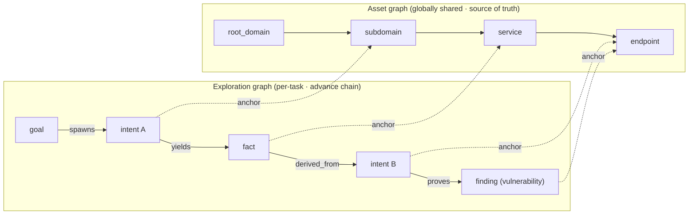
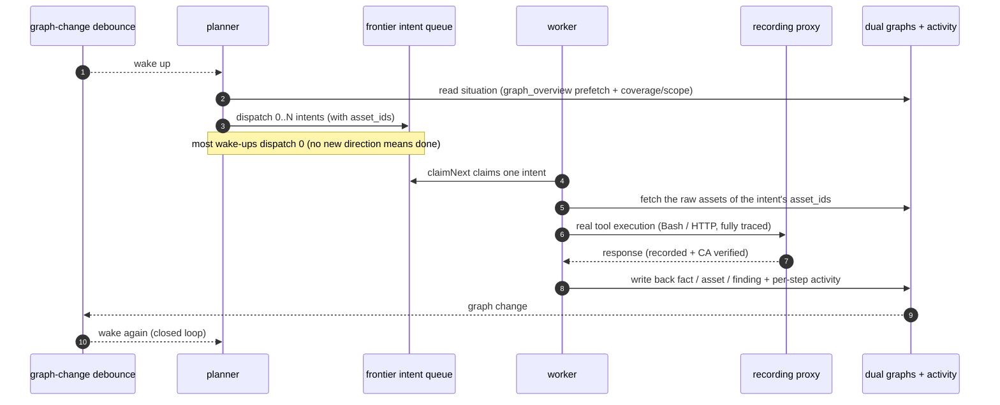

<div align="center">


# SuperArtex

**Autonomous penetration testing that keeps its receipts.**

Self-hosted multi-agent offensive security. A planner explores, workers run real tools,
and every finding stays bound to the assets and HTTP traffic that prove it.

[](LICENSE)
[](go.mod)

[Quick start](#quick-start) · [Toolkit](#toolkit) · [How it works](#how-it-works) · [Installation](#installation) · [Configuration](#configuration) · [Security](SECURITY.md)

</div>

---

## What SuperArtex is

SuperArtex is a self-hosted, LLM-driven penetration testing platform — not a chat wrapper around
a scanner. A planner splits a goal into intents, workers execute them with real tools, and the
results are written back into **two linked graphs**: one for what you know about the target, one
for how the test is progressing. Every finding can carry the captured request and response that
justify it, and every autonomous action passes through scope rules, approval gates and budgets.

- **It explores, it doesn't chat.** Goal decomposition, intent dispatch, worker execution and
  write-back form a closed loop that keeps advancing until the goal is proven.
- **Two graphs, one audit trail.** The shared asset graph says *what exists*; the per-task
  exploration graph says *what was tried, what it produced, and why*. Anchors link the two.
- **Findings with evidence.** A recording MITM proxy and a browser extension capture real traffic;
  findings, evidence quotes and retests are tied to the exact request/response.
- **Autonomy with brakes.** Human-in-the-loop approvals, argv-prefix rules, scope and target
  gates, token and turn budgets, a target noise governor, and prompt-injection framing on tool
  output.
- **Self-hosted and model-agnostic.** One Go binary with the Next.js UI embedded, PostgreSQL, and
  your own Anthropic/OpenAI-compatible endpoint or a local Ollama.

> **SuperArtex is an offensive-security tool.** Use it only against systems you own or are
> explicitly authorized to test. See [License and disclaimer](#license-and-disclaimer).

---

## Quick start

```bash
git clone https://github.com/whyujjwal/superartex.git
cd superartex
cp .env.example .env            # set POSTGRES_PASSWORD (and optionally an LLM key)
docker compose up -d --build    # builds from this checkout, starts PostgreSQL
```

Open **http://localhost:8787**. On the first visit `/setup` asks for the one-time setup token
printed at startup:

```bash
docker compose logs superartex | grep "Setup token"
```

There is no prebuilt Docker image to pull: the image is always built from your checkout.
Login is a single fixed account (`SUPERARTEX`) with a password you set at setup.

---

## Toolkit

### Skills

Skills are playbooks that teach the agent how to run industry-standard CLI tools. They add agent
knowledge, not a second execution path: every command still goes through the same approval gate,
scope check and audit log. **Every skill is disabled until an operator grants it to an agent.**

| Skill | What it covers |
|---|---|
| `network-recon` | nmap, rustscan, masscan, arp-scan |
| `web-fuzzing` | gobuster, ffuf, feroxbuster, dirsearch, httpx |
| `vuln-scan` | nuclei, nikto, wpscan, wafw00f, dalfox |
| `sqli-audit` | sqlmap: detect an injection on one in-scope parameter, prove access, stop |
| `osint-recon` | subfinder, amass, theHarvester, sherlock |
| `cloud-audit` | prowler, scout, trivy, kube-hunter, kube-bench (read-only posture) |
| `password-audit` | hashcat, john (offline, hashes the task holds), hydra (one in-scope service, rate-capped) |
| `forensics-ctf` | binwalk, exiftool, steghide, zsteg, volatility3 (read-only) |
| `exploit-dev` | checksec, gdb+gef, ropper, pwntools — lab/CTF binaries |

### Background scan runner

Long runs of those binaries go through `start_scan_job` (`task_id`, `tool`, `args`). The runner
executes the binary directly with an argv list — no shell, no shell metacharacters, and only
tools on a code-level allowlist. `get_scan_job` and `wait_scan_job` read results,
`cancel_scan_job` stops a job.

- **Caching**: a successful run with the same task and the same argv is never executed again; the
  repeat is marked `cached`.
- **Concurrency**: at most 4 jobs at once, 2 per tool.
- **Circuit breaker**: after 3 failures a tool pauses for 15 minutes on that task.
- **Durability**: output is capped, and a restart marks leftover running jobs as failed.

The **Processes** page (`/function/processes`) streams the job list live, filters it, and
cancels a live job.

### Typed scan wrappers

Each allowlisted scanner also has a structured tool — for example `nmap_scan` with `target`,
`ports`, `service_version` — that maps typed parameters to argv and submits through the same
runner: same cache, same caps, same audit. About 25 wrappers ship (`httpx_probe`,
`nuclei_scan`, `subfinder_enum`, `trivy_scan`, `masscan_ports`, …), bound to the worker, pentest
and auto agents by default; you can rebind per agent.

Interactive attack tools (sqlmap, hashcat, john, hydra) deliberately get **no** typed wrapper and
no background runner: they stay on the one approval-gated Bash path.

### Workflows

`/function/workflows` chains typed wrappers into an ordered step list with stop/continue-on-failure
and runs it against a task you pick. Each step is an ordinary recorded scan job; run history shows
per-step status. Starting a run is an operator decision — verify the task's scope first.

### CTF solver

A built-in `ctf` agent is seeded with a classify → pick-skill → attempt → verify → iterate prompt
and visibility on the lab skills (`exploit-dev`, `forensics-ctf`, `sqli-audit`, `password-audit`,
`web-fuzzing`, `vuln-scan`, `network-recon`). It works on challenge files in the task workspace
or deliberately vulnerable lab targets. Nothing about it changes the approval gates: destructive
steps still queue for your decision.

### Task templates

Built-in templates, seeded once and never re-seeded after you delete one: **Bug Bounty Recon**,
**Network Penetration Test**, **Cloud Security Audit**, **API Security Assessment**,
**CTF Binary Challenge**, and **AD Security Audit** (read-only posture review). Applying one
copies its goal into a new task.

### Deliberate boundaries

No C2/WebShell session manager and no AD lateral-movement playbooks — every execution path in
this product goes through the same approval gate, target scope check and audit log, and that is
deliberate.

---

## How it works

### Dual-graph architecture

SuperArtex separates *what the goals are* from *how far testing has progressed* into two
independent graphs linked by anchors:

- **Asset graph (shared across tasks).** One source of truth for `root_domain / subdomain / ip /
  service / app / endpoint`, owned by companies. Parent-child relationships and deduplication
  keys are computed by the program; agents only submit raw observations.
- **Exploration graph (per task).** The task's reasoning and progress: `goal / intent / fact /
  finding / hint` nodes connected by `spawns / derived_from / yields / proves` edges into a
  lineage chain.
- **Anchors link them.** `exploration_anchors(node_id, asset_id)` ties intents, facts and findings
  to concrete assets — which assets a direction touched, and which intents tested a given asset.
  This also powers asset test coverage and the coverage graph.



The **planner** reads the exploration graph, judges goals, and dispatches intents only when
there is an uncovered direction. A **worker** claims one intent, executes it, writes
assets/facts/findings back into both graphs, then stops.

### The engine loop

The engine is event-driven: any graph change wakes the planner, workers claim and execute
intents, write-back triggers the next round, until `prove_goal` closes the task.



### Durable attack chains, shared worker memory

Real attack chains are multi-step and ordered. The planner keeps a **todolist retained per task
across wake-ups**: it records the chain once, then dispatches the next step only when its
prerequisites are satisfied by facts. Workers can also **search each other's execution traces**
(`search_all_worker_traces`, `list_worker_traces`, `get_worker_trace`), so observations that
never became formal facts are still reusable by the next worker.

---

## Safety model

- **Interception gate**: every tool call can require human approval, with rules by `string`,
  `regex`, or **argv prefix**. Each approval records who decided: `human`, `rule`, `model` or
  `system`.
- **Scope and target gate**: scope rows define the coverage denominator; assets outside the
  declared scope are not explored. The target gate (off by default) can refuse destinations that
  were never approved.
- **Budgets**: `SUPERARTEX_TASK_BUDGET_TOKENS` / `SUPERARTEX_TASK_BUDGET_TURNS` cap a whole
  task; `SUPERARTEX_INTENT_BUDGET_TOKENS` / `SUPERARTEX_INTENT_BUDGET_TURNS` cap one worker run.
  Near the limit the task enters a forced wrap-up instead of dying mid-step.
- **Noise governor**: `SUPERARTEX_NOISE_PROFILE=quiet|balanced|aggressive` paces the requests
  SuperArtex sends to targets (per-host rate, burst, in-flight limits, jitter, backoff on
  429/503, short GET caching).
- **Untrusted-output boundary** (on by default): tool results are framed between nonce-tagged
  markers so the model treats them as data, not instructions. Disable with
  `SUPERARTEX_UNTRUSTED_BOUNDARY=0`.

## Evidence, not chat logs

- **Recording MITM proxy** (`:8788`) with a generated CA: every Bash/HTTP tool call is traced,
  and request/response evidence can be bound to a finding.
- **Browser extension** (`extension/`) for authenticated targets: log in once (captcha, email
  OTP, 2FA included), capture the session, and the requests/responses land in the same traffic
  store. Load it unpacked from `extension/`, set your SuperArtex URL and token in the popup, and
  press **Start capture** on the tab you are browsing.
- **Burp Suite extension** (`extension-burp/`): pushes Burp Proxy traffic into the same ingest
  endpoint, so Burp-driven manual testing becomes agent-visible evidence exactly like captured
  browsing. Load `extension-burp/SuperArtexBurp.jar` under Extensions → Add → Java, configure
  the URL and token in the SuperArtex tab, press Start.
- **Verified findings**: a finding is `verified` only when a bound proof/response and verbatim
  evidence quotes support it; gzip/deflate bodies are decoded before the quote check.
- **Vulnerability retest loop**: a dedicated `retester` agent re-runs a finding and records
  `Still reproducible / Fixed / Cannot confirm`, preserving original evidence.
- **Reports and exports**: findings, evidence and task archives, with traffic snapshots kept
  encrypted at rest.

## Platform

- **LLM profiles with failover**: Anthropic, OpenAI, OpenAI-compatible relays and keyless
  Ollama; multiple profiles per task with automatic failover.
- **Token accounting**: per-task and per-session usage, cache reads/writes, and an LLM record
  view for every call.
- **Notifications**: email, generic webhook, DingTalk, Feishu, WeCom, Telegram, **Discord** and
  **Slack** — realtime or digest, with severity filtering.
- **MCP servers, skills, memory and a workspace**: extend the agent with remote tools and
  reusable playbook material.
- **Asset sync**: pull asset data from a [ScopeSentry](https://github.com/Autumn-27/ScopeSentry)
  instance by project or task, merged by company scope into the asset graph.
- **Single binary**: the Next.js UI is embedded with `go:embed`; PostgreSQL is the only external
  dependency.

---

## Installation

> Requires **PostgreSQL**; exploration requires an **LLM** (`ANTHROPIC_API_KEY` or
> `OPENAI_API_KEY`, also configurable in the UI). There is no automated release pipeline —
> build from your checkout with one of the options below.

### Option 1: install script (recommended)

```bash
git clone https://github.com/whyujjwal/superartex.git
cd superartex
./install.sh
```

The script detects or installs Docker, then offers **① all-Docker** (writes `.env`, runs
`docker compose up -d --build`) or **② local build and run** (generates `config.json`, builds the
embedded binary, starts it).

The UI listens on `127.0.0.1` by default. To reach it from another machine (or from Windows when
SuperArtex runs inside WSL), set `SUPERARTEX_BIND_ADDR=0.0.0.0` in `.env`, or keep loopback and
use a reverse proxy or SSH tunnel.

### Option 2: Docker Compose (manual)

```bash
git clone https://github.com/whyujjwal/superartex.git
cd superartex
cp .env.example .env            # set POSTGRES_PASSWORD, optionally ANTHROPIC_API_KEY
docker compose up -d --build
# → http://localhost:8787
```

The image includes a scanner toolchain (`nmap`, `nuclei`, `httpx`, `katana`, `ffuf`, `dalfox`,
`sqlmap`, `ripgrep`, `curl`, `npm`, …); `./skills` and `./data` are persisted via bind mounts.

### Option 3: build the single binary from source

```bash
cd web && npm ci && npm run build:static && cd ..
cp -r web/out server/webui/dist
CGO_ENABLED=0 go build -tags embedui -o superartex ./cmd/superartex
./start.sh
```

Only `-tags embedui` embeds the frontend into the binary. Start with `start.sh` /
`start.bat` (a daemon script that restarts after a backoff), not `./superartex` directly.

### Option 4: cross-platform archives

```bash
./build.sh --release
# output: dist/superartex-<version>-*.zip (linux/macOS amd64+arm64, windows amd64)
SUPERARTEX_TARGETS=linux/amd64,windows/amd64 ./build.sh --release
```

---

## Configuration

**Database** (`config.json`, or the `SUPERARTEX_PG_DSN` environment variable):

```json
{
  "database": {
    "host": "127.0.0.1", "port": 5432,
    "user": "superartex", "password": "yourpass",
    "dbname": "superartex", "sslmode": "disable"
  }
}
```

**LLM**: `export ANTHROPIC_API_KEY=sk-...` (or `OPENAI_API_KEY`), or configure it in the UI's
LLM page, which can also add a local Ollama server as a keyless provider (default base URL
`http://127.0.0.1:11434/v1`). Optional: `SUPERARTEX_LLM_PROVIDER`
(`anthropic | openai | openai-responses | ollama`), `SUPERARTEX_LLM_MODEL`,
`SUPERARTEX_LLM_BASE_URL`, `SUPERARTEX_LLM_PROXY`.

> **Base URL gotcha**: for the Anthropic format, enter the host **without** `/v1`
> (`https://api.anthropic.com`) — SuperArtex appends `/v1/messages`. OpenAI-format providers
> append `/chat/completions` (or `/responses`), so their base **does** end in `/v1`
> (`https://api.openai.com/v1`).

**Common flags**: `./start.sh -addr :8787 -proxy :8788` (`-addr` frontend/API, `-proxy` traffic
recording proxy).

**Noise profile** (off by default): `SUPERARTEX_NOISE_PROFILE` — `quiet` = 2 req/s per host,
`balanced` = 5 req/s, `aggressive` = 20 req/s, each with burst, in-flight, jitter, 429/503
backoff and short GET caching. The **Target noise** card in system settings changes it at runtime
and takes precedence over the variable. This is best effort, not a security boundary: raw
scanners such as nmap are not paced.

**Run budgets** (off by default): unset or `0` means unlimited. Practical floor: below 50,000
task tokens no worker starts; pick well above 70,000 for real exploration.

**Update banner** (opt-in, off by default): set `SUPERARTEX_UPDATE_RELEASES_API` to a GitHub
`releases/latest` API URL and `SUPERARTEX_UPDATE_CHECK=1` to show a dismissible banner when a
newer tag appears (checked at most once per 24 h).

### Reverse proxy (HTTPS / only exposing 443)

The frontend, API and SSE stream share port 8787, and the activity stream is same-origin by
default, so no `NEXT_PUBLIC_SSE_BASE` is needed: expose 443 and keep 8787 internal. SSE needs
buffering disabled:

```nginx
location / {
    proxy_pass http://127.0.0.1:8787;
    proxy_set_header Host $host;
    proxy_set_header X-Forwarded-For $proxy_add_x_forwarded_for;
    proxy_buffering off;
    proxy_cache off;
    proxy_read_timeout 3600s;
    proxy_http_version 1.1;
    proxy_set_header Connection "";
}
```

Login allows 10 attempts per minute per client IP. Behind a proxy, set
`SUPERARTEX_TRUSTED_PROXIES` (comma-separated CIDRs) to the address SuperArtex sees the proxy
connect from, so every user doesn't share one budget: `127.0.0.1/32` for a host-level nginx
alongside the binary; the Docker bridge gateway for nginx on the host in front of the container
(find it with `docker network inspect <project>_default`). Trust only proxies you run.

---

## Operations

### Backups

`scripts/backup.sh` dumps the Postgres database (and optionally the data directory) with
timestamped output and rotation:

```bash
scripts/backup.sh --with-data          # db dump + data/ archive, keep 14
scripts/backup.sh --keep 7             # db only, keep 7
```

Stored secrets (LLM keys, MCP env, task credentials, notification channel config, search keys,
custom-tool specs) are encrypted with `keys/secret.key`. **A database backup without that key
cannot restore those secrets**: back up `keys/` with the dump. Deployments without a persistent
disk set `SUPERARTEX_SECRET_KEY` (32 bytes, e.g. `openssl rand -base64 32`).

### Updating

Upgrading swaps the program and never touches data: the `pgdata` volume, `./data`, `./keys` and
`./skills` are preserved, and schema migrations apply automatically at startup. Restarting the new
binary is the upgrade. Back up `./data`, `keys/` and the database first.

```bash
cd superartex
./update.sh        # optional git pull, then Docker rebuild or local rebuild
```

### Development

```bash
./dev.sh    # backend(:8787) + traffic proxy(:8788) + frontend next dev(:5173)
```

- Backend: `go run ./cmd/superartex` (without `-tags embedui`, the frontend is not embedded)
- Frontend: `cd web && npm run dev` (`/api` is reverse-proxied to the backend)
- Tests: `go test ./...`
- Mock preview (no backend): `cd web && NEXT_PUBLIC_MOCK=1 npm run dev`

---

## Architecture

SuperArtex is a Go monolithic backend (Next.js UI embedded) + PostgreSQL. Agent capabilities come
from the [`norma`](https://github.com/Autumn-27/norma) SDK (`agentcore` / `tool` / `permission` /
`harness` / `memory` / `transcript`). At its core is the dual-graph architecture, plus
process-level information exchange between workers and the planner's multi-round shared todolist.

| Layer | Responsibility |
| --- | --- |
| **Frontend** | Next.js static export embedded via `go:embed`; tasks, assets, exploration and coverage graphs, traffic, processes, workflows, human-in-the-loop chat |
| **server** | `net/http` routing, JWT auth, SSE; `Manager` owns tasks, engines and DB stores |
| **engine** | One `plannerLoop` + N worker goroutines per task; intent claiming, timeout/pause/drain |
| **agent** | goals / planner / worker / mainagent / ctf / auto; `ToolSet` exposes the dual graphs as LLM tools |
| **db** | PostgreSQL persistence (pgx); embedded schema and numbered migrations applied at startup |
| **Supporting** | Recording MITM proxy, approval gate, scan-job runner, async enrichment, MCP/skills/memory/report |

---

## Security

Please report vulnerabilities privately through GitHub Security Advisories; see
[SECURITY.md](SECURITY.md).

Operational security properties:

- **Secrets at rest**: AES-256-GCM with `keys/secret.key` (or `SUPERARTEX_SECRET_KEY`). SuperArtex
  refuses to start when encrypted data exists and no usable key is available.
- **First-run claim**: `/setup` requires a one-time token printed at startup; the UI binds to
  `127.0.0.1` by default.
- **Login protection**: 10 attempts per minute per client IP, with trusted-proxy attribution.
- **Untrusted tool output**: framed as data for every agent by default (prompt-injection
  boundary).

---

## Acknowledgements

SuperArtex is a derivative work of the [ARTEX](https://github.com/BaaRai/ARTEX) project
(AGPL-3.0), which inspired this platform and formed the foundation of its codebase.

---

## License and disclaimer

### Open source license

This project is licensed under the **GNU Affero General Public License v3.0 (AGPL-3.0)**; see the
[LICENSE](LICENSE) file for the full terms. Derivative works must also be open-sourced under
AGPL-3.0 — in particular, if you modify this project and provide it to users over a network, you
must make the corresponding complete source code available to those users.

> **Important**: the open source license does not restrict how the software is used. The usage
> restrictions and disclaimer below are additional terms from the maintainers.

### Authorized use only

**SuperArtex is an offensive-security tool. Use it only against systems you own, or that you are
explicitly authorized to test** (your own lab, your organization's assets, or a bug bounty /
vulnerability disclosure program's targets within their published scope and rules of engagement).
Any use without authorization violates these terms.

**Prohibited**: scanning, probing, exploiting or attacking any system without the explicit
authorization of its owner; testing outside a program's published scope; illegal intrusion, data
theft, extortion, denial of service, or any criminal activity.

Users must comply with all laws and regulations of their country or region regarding
cybersecurity, data protection and computer crime. **All legal liability and consequences
arising from the use of this tool are borne by the user.**

### Disclaimer

This project is provided "as is", without any express or implied warranty. The authors and
contributors are not liable for any direct or indirect loss, data loss, system damage or legal
dispute caused by the use of this tool (whether used properly or not). **Downloading, installing
or using this project means you have read, understood and agreed to all of the above terms.**
