<div align="center">


# SuperArtex

**Autonomous penetration testing that keeps its receipts.**

Self-hosted multi-agent offensive security. A planner explores, workers run real tools,
and every finding stays bound to the assets and HTTP traffic that prove it.

[](LICENSE)
[](go.mod)

[Quick start](#quick-start) · [Toolkit](#toolkit) · [How it works](#how-it-works) · [Installation](#installation) · [Configuration](#configuration) · [Security](SECURITY.md)

</div>

---

<p align="center">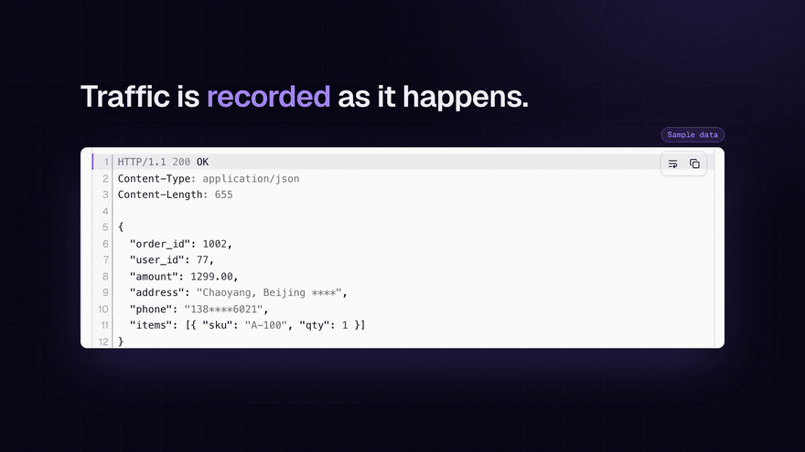</p>

<p align="center"><sub>Excerpt from the 55-second product film — the full cut ships with the project's release announcement.<br/>
<!-- MAINTAINER: replace this line with the real link, e.g. Watch the full film: <https://…> --></sub></p>

## What it does

You give it a goal and a scope. SuperArtex decomposes the goal into intents, dispatches them to concurrent workers, and lets those workers run `nmap`, `ffuf`, `nuclei`, `sqlmap` or anything else through Bash — every command auditable, every claim attached to the request that produced it. Then it does the part most scanners skip: when a worker says "this is exploitable", the finding is either backed by captured bytes and verbatim quotes, or it is not `verified`.

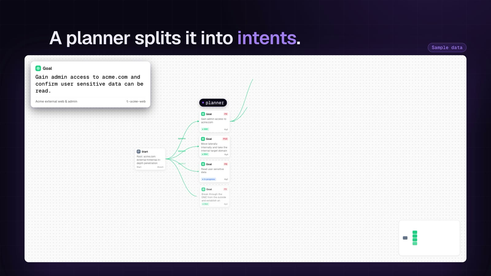

### A planner, workers and a graph

The **planner** reads the exploration graph and dispatches an intent only when there is an uncovered direction; a **worker** claims one intent, executes it, writes assets, facts and findings back, then stops. Three workers run by default (configurable), and the planner keeps a per-task todolist across wake-ups so a multi-step chain advances instead of restarting each round.

Two graphs are linked by anchors: a shared **asset graph** (root domain → subdomain → service → endpoint) that says what exists, and a per-task **exploration graph** (goal → intent → fact → finding → hint, linked by `spawns`, `derived_from`, `yields`, `proves`) that says what was tried and why.

<p align="center">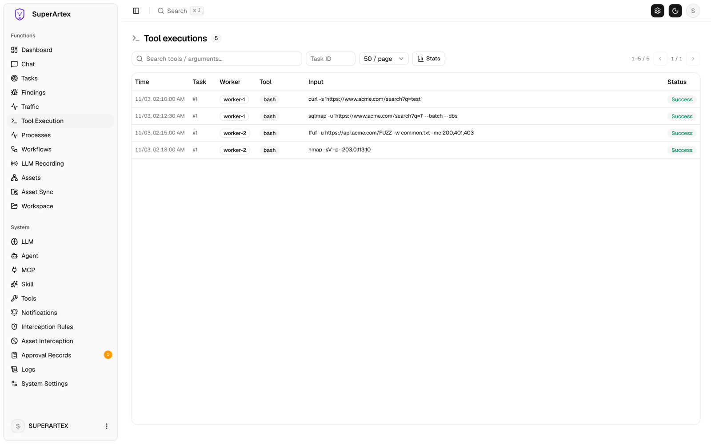<br/>
<sub>The real Tool execution page — every command a worker ran, which task and worker ran it, and whether it succeeded.</sub></p>

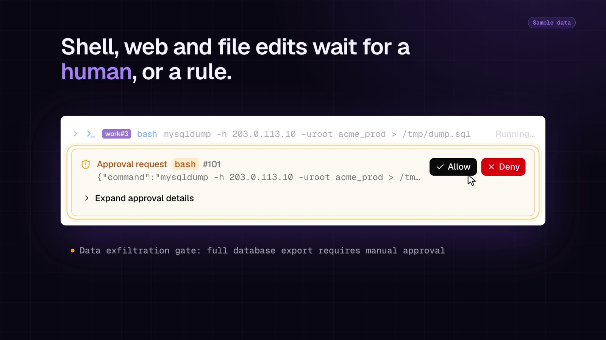

### It stops and asks

By default the approval gate covers `Bash`, `WebFetch`, `web_search`, `shell_open`, `shell_send`, and file edits (`Write`, `Edit`, `MultiEdit`). Rules match by `string`, `regex` or **argv prefix**, carry an `allow` / `ask` / `deny` action, run in priority order, and the first match wins. Every settled approval records who decided: `human`, `rule`, `model` or `system`.

Built-in deny rules ship enabled for the unrecoverable cases: `rm -rf`, deleting system paths, `mkfs`, `dd` onto a device, fork bombs, `shutdown`/`reboot`, `kill -9 -1`, firewall flushes, SQL `DROP`/`TRUNCATE`, Redis `FLUSHALL`, curl/Python/axios `DELETE`, and bulk-clear endpoint paths. An "always allow" argv rule can never name a shell, interpreter, launcher, package manager, container CLI or destructive utility — that list is code-owned, with no setting to override it.

<table>
<tr>
<td width="50%">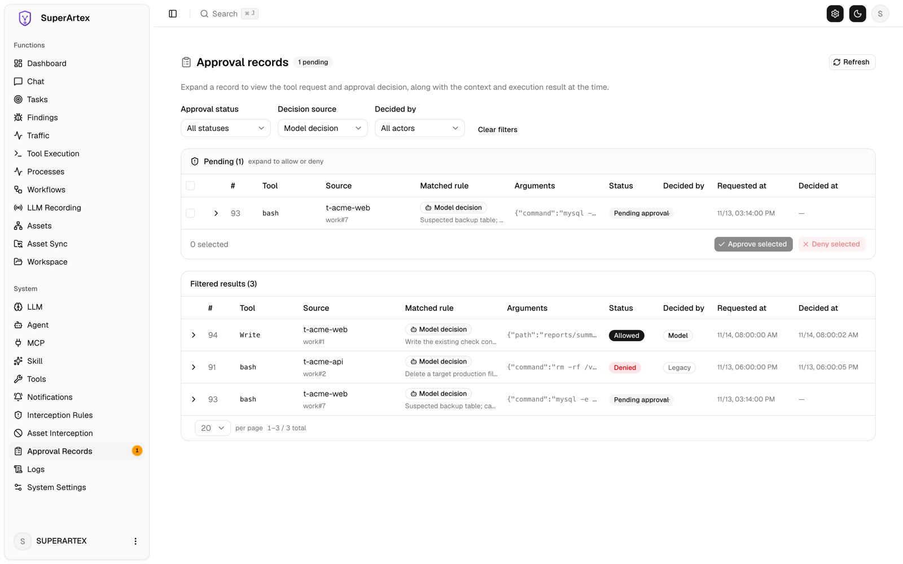<br/><sub><strong>Approval records</strong> — the matched rule, the arguments, and the actor in "Decided by".</sub></td>
<td width="50%">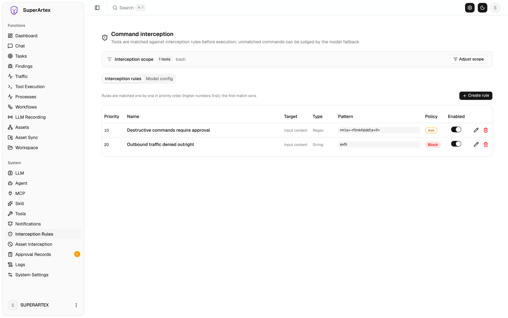<br/><sub><strong>Interception rules</strong> — priority-ordered; a deny blocks outright, an ask queues for a human.</sub></td>
</tr>
</table>

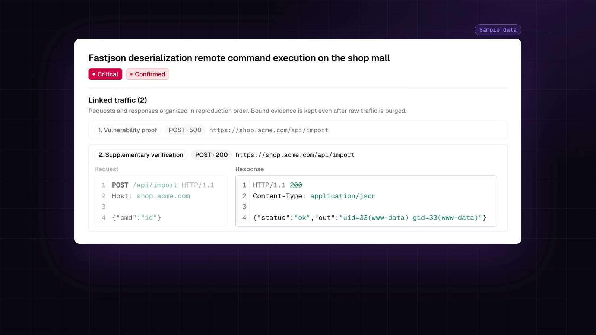

### Findings keep their receipts

Findings bind to captured request/response snapshots tagged by role — `baseline`, `proof`, `verification`, `supporting`. A finding is marked **verified** only when the agent declared a proof level of 3 or higher **and** every evidence quote appears verbatim in a bound response. Gzip/deflate bodies are decoded first, quotes under 8 characters are ignored, and an unreadable or binary body fails closed (`not_assessed`) rather than guessing.

Traffic reaches that store three ways: the recording MITM proxy (`:8788`, with its own generated CA) traces every Bash and HTTP call; a browser extension (`extension/`) captures authenticated sessions — captcha, email OTP, 2FA included; and a Burp Suite extension (`extension-burp/SuperArtexBurp.jar`) pushes Proxy traffic into the same ingest endpoint, so manual testing becomes agent-visible evidence.

Retesting is operator-triggered: from the finding details or a task's Retests tab you start a separate session with the `retester` agent, which reads the original evidence and constraints, re-verifies against the live target, and records `Still reproducible` / `Fixed` / `Inconclusive` — without editing the original report. A `reproduced` or `fixed` verdict independently upgrades an unverified finding.

<table>
<tr>
<td width="50%"><br/><sub><strong>Findings</strong> — cross-task overview: severity, asset, status, verification state, evidence count.</sub></td>
<td width="50%">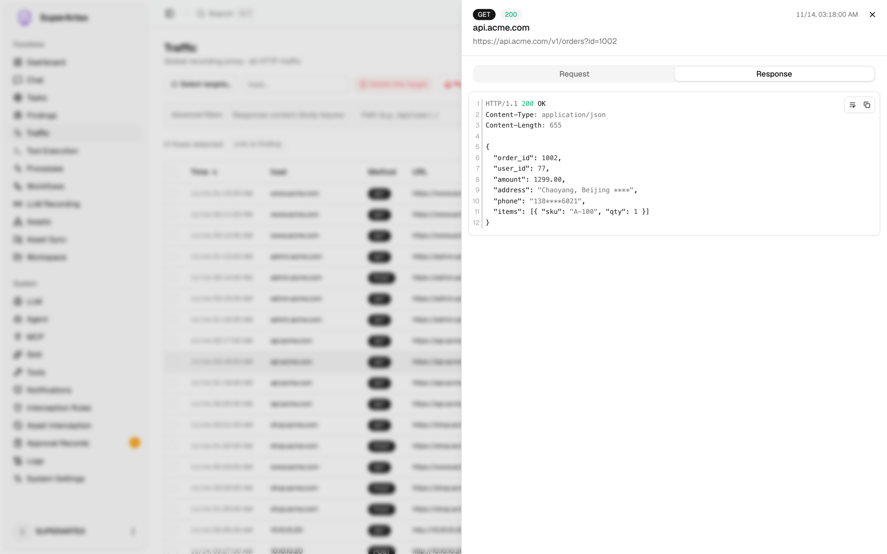<br/><sub><strong>Traffic</strong> — the recorded request and response, byte for byte, from the recording proxy.</sub></td>
</tr>
</table>

### Screenshots

| | | |
|---|---|---|
| <br/><sub>Findings</sub> | <br/><sub>Traffic</sub> | <br/><sub>Tool execution</sub> |
| <br/><sub>Approval records</sub> | <br/><sub>Interception rules</sub> | 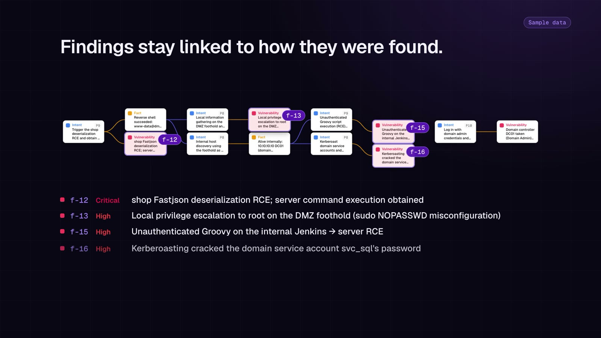<br/><sub>The chain, from the film</sub> |

All UI screenshots are the app's demo mode; the film stills are rendered from the same fictional demo data. Neither shows a real target.

---

## What is and is not gated

The gated surface is explicit and small. Knowing where it ends is more useful than a slogan.

| Surface | Default | Reality |
|---|---|---|
| `Bash`, `WebFetch`, `web_search`, `shell_open`, `shell_send`, `Write`, `Edit`, `MultiEdit` | **Gated** | Rules first (first match wins), then the optional model judge, then a human for `ask`. Unmatched calls pass unless you enable the judge. |
| `Read`, `Grep`, `LS`, traffic and graph tools | **Not gated** | Read-only platform and target reads. |
| `start_scan_job` + the 25 typed wrappers | **Not gated** | Argv-only, no shell, 28-binary allowlist, cache, 4 global / 2 per-tool caps, circuit breaker. Intercept rules do not see these calls. |
| Workflow runs | **Not gated** | Operator-started; each step is an ordinary scan job on the same runner. |
| Target gate (host block rules + IP pins) | **Off** | Per-task opt-in, settable through the task API only; no UI toggle ships. |
| Task scope | **Advisory** | A coverage denominator and prompt context, not an enforced network boundary. |
| Noise governor | **Best effort** | Paces WebFetch, HTTP custom tools, enrich probes and proxied Bash. Scanners that bypass the proxy are not paced. |
| Untrusted-output framing | **On** | Tool output wrapped in nonce-tagged markers and framed as data. A prompt-level boundary, not a sandbox. |
| Secrets at rest | **On** | AES-256-GCM for LLM keys, MCP env, task credentials, notification config, custom tool specs, and the stored request/response **header** blocks of evidence snapshots. Captured bodies are hashed files on disk — not encrypted. |
| C2 sessions, AD lateral movement | **Absent** | Not shipped, by design. |

---

## Quick start

```bash
git clone https://github.com/whyujjwal/superartex.git
cd superartex
cp .env.example .env            # set POSTGRES_PASSWORD (and optionally an LLM key)
docker compose up -d --build    # builds from this checkout, starts PostgreSQL
```

Open **http://localhost:8787**. On the first visit `/setup` asks for the one-time setup token printed at startup (`docker compose logs superartex | grep "Setup token"`). There is no prebuilt image to pull: the image is always built from your checkout. Login is a single fixed account (`SUPERARTEX`) with the password you set at setup.

---

## Toolkit

### Skills

Skills are Markdown playbooks that teach an agent how to drive a CLI tool correctly — flags, ordering, stop conditions, what not to touch. They add knowledge, not a second execution path: when a playbook says "run `ffuf`", the agent still runs `ffuf` through Bash, under the same rules.

19 skills ship in `skills/`. Visibility is per agent, and mostly off:

| Skill | What it covers |
|---|---|
| `network-recon` · `web-fuzzing` · `vuln-scan` | nmap/rustscan/masscan/arp-scan · gobuster/ffuf/feroxbuster/dirsearch/httpx · nuclei/nikto/wpscan/wafw00f/dalfox |
| `sqli-audit` · `osint-recon` · `bbot-recon` | sqlmap (detect one in-scope injection, prove access, stop) · subfinder/amass/theHarvester/sherlock · bbot recursive recon under program-policy gates |
| `cloud-audit` · `password-audit` · `forensics-ctf` | prowler/scout/trivy/kube-hunter/kube-bench (read-only) · hashcat/john offline, hydra rate-capped · binwalk/exiftool/steghide/zsteg/volatility3 |
| `exploit-dev` · `api-recon` · `api-security` | checksec/gdb+gef/ropper/pwntools in lab/CTF only · endpoint harvesting · BOLA/IDOR/JWT/GraphQL testing |
| `codeaudit` · `patch-diff` · `edr-bypass-re` · `php2shell` · `rea` · `scopesentry` · `playwright-cli` | source audit · n-day recovery · defence-telemetry analysis · LFI→RCE · MCP-backed RE and asset tooling |

Only `api-recon` is granted by default (to `auto`, `pentest` and `worker`), plus the seven lab skills the seeded `ctf` agent ships with. Every other skill starts invisible and is switched on per agent. `rea` and `scopesentry` also need their MCP servers configured.

### Background scan runner

Long runs go through `start_scan_job` (`task_id`, `tool`, `args`). The runner executes the binary directly with an argv list — no shell, no shell metacharacters, and only tools on a 28-binary code-level allowlist. `get_scan_job` and `wait_scan_job` read results; `cancel_scan_job` stops a job.

- **Caching**: a successful run with the same task and argv is never executed twice; the repeat returns `cached`.
- **Concurrency**: at most 4 jobs at once, 2 per tool.
- **Circuit breaker**: after 3 failures a tool pauses for 15 minutes on that task.
- **Durability**: output capped at 256 KiB; a restart marks leftover running jobs as failed.

The **Processes** page (`/function/processes`) streams the job list live over SSE, filters by status and cancels a running job.

### Typed scan wrappers

Each allowlisted recon or posture scanner also has a structured tool — `nmap_scan` with `target`, `ports`, `service_version` — mapping typed parameters to argv through the same runner: same cache, same caps, same audit trail. 25 wrappers ship, bound to the `worker`, `pentest` and `auto` agents by default and rebindable per agent.

Interactive attack tools (sqlmap, hashcat, john, hydra) deliberately get **no** wrapper and no background runner: they stay on the approval-gated Bash path. A wrapper still needs its binary — if it is missing the job fails with `X is not installed` (see [Toolkit binaries](#toolkit-binaries)).

### Workflows

`/function/workflows` chains typed wrappers into an ordered step list with stop/continue-on-failure and runs it against a task you pick. Each step is an ordinary recorded scan job; run history shows per-step status. Starting a run is an operator decision — verify the task's scope first.

### CTF solver

A built-in `ctf` agent ships with a classify → pick-skill → attempt → verify → iterate prompt and visibility on the lab skills (`exploit-dev`, `forensics-ctf`, `sqli-audit`, `password-audit`, `web-fuzzing`, `vuln-scan`, `network-recon`). It works on challenge files in the task workspace or targets you explicitly mark as deliberately vulnerable. Nothing about it changes the approval gates.

### Task templates

Six built-in templates, seeded once and never re-seeded after you delete one: **Bug Bounty Recon**, **Network Penetration Test**, **Cloud Security Audit**, **API Security Assessment**, **CTF Binary Challenge**, and **AD Security Audit** (read-only posture review). Each names the skills to grant first.

### Toolkit binaries

The Docker image ships, pinned (and checksum-verified where upstream publishes checksums): `nmap`, `nuclei`, `httpx`, `subfinder`, `katana`, `ffuf`, `dalfox`, `sqlmap`, `bbot` (+ chromium), `ripgrep`, `curl`, `wget`, `git`, `jq`, `vim`, Node 22, Playwright with Chromium.

Everything else — rustscan, masscan, arp-scan, gobuster, feroxbuster, dirsearch, nikto, wpscan, wafw00f, amass, theHarvester, sherlock, prowler, scout, trivy, kube-hunter, kube-bench, binwalk, exiftool, volatility3, steghide, zsteg, hashcat, john, hydra, checksec, gdb, ropper, pwntools — you install yourself, on the host or in a derived image. Their skills and wrappers exist either way; the binary is what decides whether they run.

### Deliberate boundaries

No C2 or WebShell session manager, no AD lateral-movement playbooks, no autonomous post-exploitation framework. If an engagement needs that, use a dedicated tool under your own supervision.

---

## Platform

- **LLM profiles with failover**: Anthropic, OpenAI, OpenAI-compatible relays and keyless Ollama; multiple profiles per task with automatic failover.
- **Token accounting**: per-task and per-session usage, cache reads/writes, and an LLM record view for every call.
- **Notifications**: 8 channels — email, generic webhook, DingTalk, Feishu, WeCom, Telegram, Discord and Slack — realtime or digest, with severity filtering.
- **MCP servers, skills and a workspace**: extend the agent with remote tools, reusable playbooks and files.
- **Asset sync**: pull assets from a [ScopeSentry](https://github.com/Autumn-27/ScopeSentry) instance by project or task, merged by company scope into the asset graph.
- **Single binary**: the Next.js UI is embedded with `go:embed`; PostgreSQL is the only external dependency.

---

## How it works

### Dual-graph architecture

The **asset graph** is shared across tasks: one source of truth for `root_domain / subdomain / ip / service / app / endpoint`, owned by companies. Parent-child relationships and deduplication keys are computed by the program; agents only submit raw observations. The **exploration graph** is per task: `goal / intent / fact / finding / hint` nodes joined by `spawns / derived_from / yields / proves` into a lineage chain. **Anchors** (`exploration_anchors(node_id, asset_id)`) tie intents, facts and findings to concrete assets — which assets a direction touched, which intents tested a given asset — and also power asset test coverage.

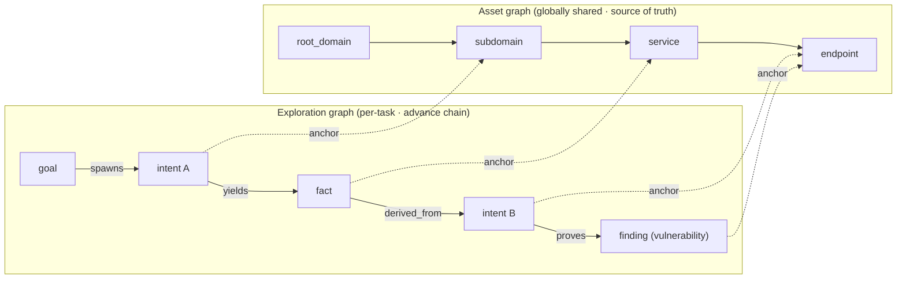

The planner reads the exploration graph, judges goals, and dispatches intents only when there is an uncovered direction. A worker claims one intent, executes it, writes assets/facts/findings back into both graphs, then stops.

### The engine loop

The engine is event-driven: a graph change wakes the planner after an 800 ms debounce, workers claim and execute intents, write-back triggers the next round, until `prove_goal` closes the task.

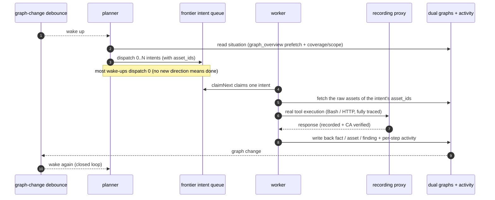

Real chains are multi-step and ordered, so the planner keeps the **todolist retained per task across wake-ups**: it records the chain once, then dispatches the next step only when facts satisfy its prerequisites. Workers can also **search each other's execution traces** (`search_all_worker_traces`, `list_worker_traces`, `get_worker_trace`), so observations that never became formal facts stay reusable.

---

## Installation

> Requires **PostgreSQL**; exploration requires an **LLM** (`ANTHROPIC_API_KEY` or `OPENAI_API_KEY`, also
> configurable in the UI). There is no automated release pipeline — build from your checkout.

**1 · install script (recommended)**

```bash
git clone https://github.com/whyujjwal/superartex.git && cd superartex && ./install.sh
```

It detects or installs Docker, then offers **① all-Docker** (writes `.env`, runs `docker compose up -d --build`) or **② local build and run** (generates `config.json`, builds the embedded binary, starts it). The UI listens on `127.0.0.1` by default; set `SUPERARTEX_BIND_ADDR=0.0.0.0` to reach it from another machine (or from Windows when SuperArtex runs inside WSL), or keep loopback and use a reverse proxy or SSH tunnel.

**2 · Docker Compose (manual)**

```bash
git clone https://github.com/whyujjwal/superartex.git && cd superartex
cp .env.example .env            # set POSTGRES_PASSWORD, optionally ANTHROPIC_API_KEY
docker compose up -d --build    # → http://localhost:8787
```

`./data` and `./keys` (JWT + secret keys) are bind-mounted; `./skills` is mounted over the image's copy so skill edits need no rebuild.

**3 · single binary from source**

```bash
cd web && npm ci && npm run build:static && cd ..
cp -r web/out server/webui/dist
CGO_ENABLED=0 go build -tags embedui -o superartex ./cmd/superartex
./start.sh
```

Only `-tags embedui` embeds the frontend. Start with `start.sh` / `start.bat` (a supervisor that restarts after a backoff and forwards SIGTERM), not `./superartex` directly.

**4 · cross-platform archives**

```bash
./build.sh --release    # dist/superartex-<version>-*.zip, linux/macOS amd64+arm64, windows amd64
SUPERARTEX_TARGETS=linux/amd64,windows/amd64 ./build.sh --release
```

---

## Configuration

**Database** (`config.json`, or `SUPERARTEX_PG_DSN`):

```json
{ "database": { "host": "127.0.0.1", "port": 5432, "user": "superartex",
                "password": "yourpass", "dbname": "superartex", "sslmode": "disable" } }
```

**LLM**: `export ANTHROPIC_API_KEY=sk-...` (or `OPENAI_API_KEY`), or configure it in the UI's LLM page,
which can also add a local Ollama server as a keyless provider (default `http://127.0.0.1:11434/v1`).
Optional: `SUPERARTEX_LLM_PROVIDER` (`anthropic | openai | openai-responses | ollama`), `SUPERARTEX_LLM_MODEL`, `SUPERARTEX_LLM_BASE_URL`, `SUPERARTEX_LLM_PROXY`.

> **Base URL gotcha**: for the Anthropic format enter the host **without** `/v1` (`https://api.anthropic.com`) — SuperArtex appends `/v1/messages`. OpenAI-format providers append `/chat/completions` (or `/responses`), so their base **does** end in `/v1` (`https://api.openai.com/v1`).

**Common flags**: `./start.sh -addr :8787 -proxy :8788` (`-addr` frontend/API, `-proxy` traffic proxy).

**Interception**: *Interception Rules* holds the rules, the enabled-tool scope and the optional model
judge (off until you enable it and pick a profile). *Approval Records* shows every decision and its actor.

**Noise profile** (off by default): `SUPERARTEX_NOISE_PROFILE` — `quiet` 2 req/s per host, `balanced` 5,
`aggressive` 20, each with burst, in-flight caps, jitter, 429/503 backoff and short GET caching. The
**Target noise** card in system settings overrides the variable at runtime. Best effort, not a security
boundary: raw scanners such as nmap are not paced.

**Run budgets** (off by default): unset or `0` means unlimited. Below 50,000 task tokens no worker starts; pick well above 70,000 for real exploration.

**Update banner** (opt-in): set `SUPERARTEX_UPDATE_RELEASES_API` to a GitHub `releases/latest` URL and `SUPERARTEX_UPDATE_CHECK=1` to show a dismissible banner when a newer tag appears (checked at most once per 24 h).

**Reverse proxy (HTTPS / 443 only)**: frontend, API and SSE share port 8787 and the activity stream is
same-origin, so no `NEXT_PUBLIC_SSE_BASE` is needed. SSE needs buffering off:

```nginx
location / {
    proxy_pass http://127.0.0.1:8787;
    proxy_set_header Host $host;
    proxy_set_header X-Forwarded-For $proxy_add_x_forwarded_for;
    proxy_buffering off;
    proxy_cache off;
    proxy_read_timeout 3600s;
    proxy_http_version 1.1;
    proxy_set_header Connection "";
}
```

Login allows 10 attempts per minute per client IP, then an escalating block. Behind a proxy set `SUPERARTEX_TRUSTED_PROXIES` (comma-separated CIDRs) to the address SuperArtex sees the proxy connect from, so users don't share one budget: `127.0.0.1/32` for a host-level nginx alongside the binary; the Docker bridge gateway for nginx on the host in front of the container (`docker network inspect <project>_default`). Trust only proxies you run.

---

## Operations

**Backups.** `scripts/backup.sh` dumps Postgres (and optionally `data/`) with rotation:

```bash
scripts/backup.sh --with-data    # db dump + data/ archive, keep 14
scripts/backup.sh --keep 7       # db only, keep 7
```

Stored secrets (LLM keys, MCP env, task credentials, notification config, search keys, custom-tool specs, evidence header blocks) are encrypted with `keys/secret.key`. **A database backup without that key cannot restore those secrets** — back up `keys/` with the dump. Deployments without a persistent disk set `SUPERARTEX_SECRET_KEY` (32 bytes, e.g. `openssl rand -base64 32`).

**Updating.** Upgrading swaps the program and never touches data: the `pgdata` volume, `./data`, `./keys` and `./skills` are preserved, and schema migrations apply at startup. Restarting the new binary is the upgrade. Back up first: `cd superartex && ./update.sh` (optional git pull, then Docker rebuild or local rebuild).

**Development.**

```bash
./dev.sh    # backend(:8787) + traffic proxy(:8788) + frontend next dev(:5173)
```

- Backend: `go run ./cmd/superartex` (without `-tags embedui` the frontend is not embedded)
- Frontend: `cd web && npm run dev` (`/api` is reverse-proxied to the backend)
- Tests: `go test ./...`
- Mock preview (no backend): `cd web && NEXT_PUBLIC_MOCK=1 npm run dev`

---

## Architecture

A Go monolith (Next.js UI embedded) plus PostgreSQL. Agent capabilities come from the [`norma`](https://github.com/Autumn-27/norma) SDK (`agentcore` / `tool` / `permission` / `harness` / `transcript` / `skill` / `llm`). At its core is the dual-graph design, plus process-level information exchange between workers and the planner's multi-round shared todolist.

| Layer | Responsibility |
| --- | --- |
| **Frontend** | Next.js static export embedded via `go:embed`; tasks, assets, exploration and coverage graphs, traffic, processes, workflows, human-in-the-loop chat |
| **server** | `net/http` routing, JWT auth, SSE; `Manager` owns tasks, engines and DB stores |
| **engine** | One `plannerLoop` + N worker goroutines per task; intent claiming, timeout/pause/drain |
| **agent** | goals / planner / worker / mainagent / pentest / auto / ctf; `ToolSet` exposes the dual graphs as tools |
| **db** | PostgreSQL persistence (pgx); embedded schema and numbered migrations applied at startup |
| **Supporting** | Recording MITM proxy, approval gate, scan-job runner, async enrichment, MCP/skills/report |

---

## Security

Report vulnerabilities privately through GitHub Security Advisories; see [SECURITY.md](SECURITY.md).

- **Secrets at rest**: AES-256-GCM with `keys/secret.key` (or `SUPERARTEX_SECRET_KEY`). SuperArtex refuses to start when encrypted data exists and no usable key is available.
- **First-run claim**: `/setup` requires a one-time token printed at startup; the UI binds to `127.0.0.1` by default.
- **Login protection**: 10 attempts per minute per client IP, with trusted-proxy attribution.
- **Untrusted tool output**: framed as data for every agent by default (prompt-injection boundary).
- **Recording proxy**: generates its own CA; Bash tool calls carry the proxy URL and CA so HTTPS stays verifiable instead of skipping certificate checks.

The exact scope of all of this — including what is *not* covered — is in
[What is and is not gated](#what-is-and-is-not-gated).

---

## Design choices

- **An explicit gate, not a promise.** The gated tool list is short, written in code, and published above. Everything outside it is described as outside it.
- **Evidence over adjectives.** `verified` comes from captured bytes and verbatim quotes, not from a confident sentence.
- **Argv, never a shell string.** Background scans are `exec(binary, args…)` against a fixed allowlist, which removes a class of injection bugs.
- **Operator-triggered side effects.** Retests and workflows start when a human starts them.
- **One binary, one database.** The UI is embedded; PostgreSQL is the only service you must run.
- **AGPL-3.0 throughout.** Improvements stay available to the people running it.

---

## Acknowledgements

SuperArtex is a **derivative work of [ARTEX](https://github.com/BaaRai/ARTEX)** (AGPL-3.0), originally
authored by **Autumn-27**. The engine — dual graphs, planner/worker loop, agent design, approval gate,
recording proxy — is upstream's work, and this project would not exist without it.

What SuperArtex adds on top of that engine: the rebrand, the background scan runner and its Processes
page, the typed scan wrappers, workflows, the CTF solver agent, additional skills, Discord and Slack
notification channels, and the Burp Suite extension.

Also credited:

- [`norma`](https://github.com/Autumn-27/norma) — the agent SDK this project builds on.
- [ScopeSentry](https://github.com/Autumn-27/ScopeSentry) — asset-mapping platform; an asset sync source and a skill.
- [bbot](https://github.com/blacklanternsecurity/bbot) — recursive recon orchestrator bundled in the image.
- Individual skills carry their own attribution notes in `skills/*/SKILL.md` where a playbook was adapted from another project.

<p align="center">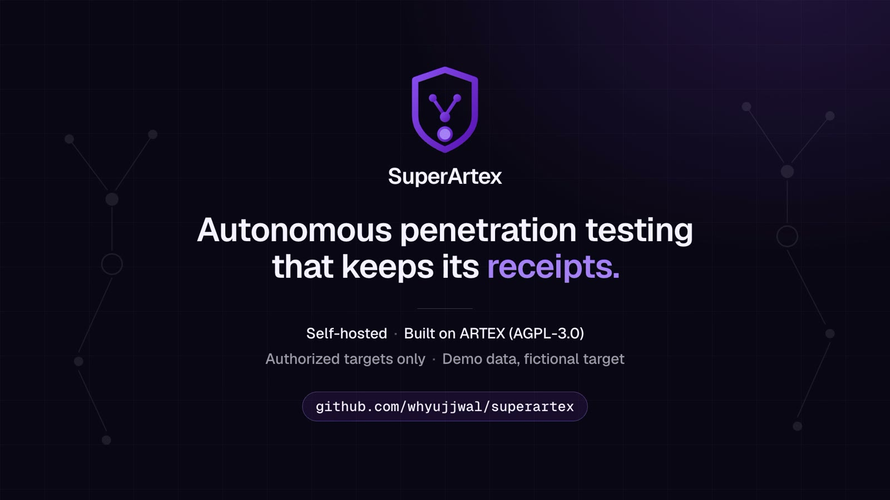</p>

---

## Authorized use only

> **SuperArtex is an offensive-security tool. Use it only against systems you own, or that you are
> explicitly authorized to test** — your own lab, your organization's assets, or a bug bounty /
> vulnerability disclosure program's targets within their published scope and rules of engagement.

**Prohibited**: scanning, probing, exploiting or attacking any system without the explicit authorization of its owner; testing outside a program's published scope; illegal intrusion, data theft, extortion, denial of service, or any criminal activity.

Users must comply with all laws and regulations of their country or region regarding cybersecurity, data protection and computer crime. **All legal liability and consequences arising from the use of this tool are borne by the user.** No configuration option in this repository makes an unauthorized test authorized.

---

## License

**GNU Affero General Public License v3.0 (AGPL-3.0)** — see [LICENSE](LICENSE). Derivative works must also be open-sourced under AGPL-3.0; in particular, if you modify this project and provide it to users over a network, you must make the corresponding complete source code available to those users.

Provided "as is", without any express or implied warranty. The authors and contributors are not liable for any direct or indirect loss, data loss, system damage or legal dispute caused by the use of this tool. **Downloading, installing or using this project means you have read, understood and agreed to all of the above.**
