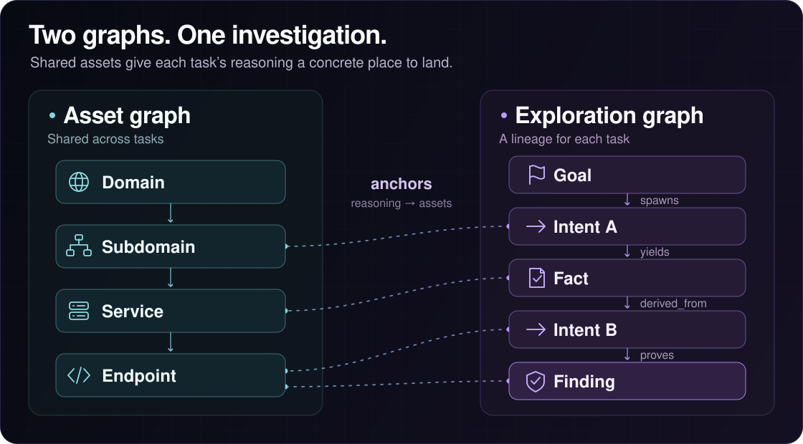
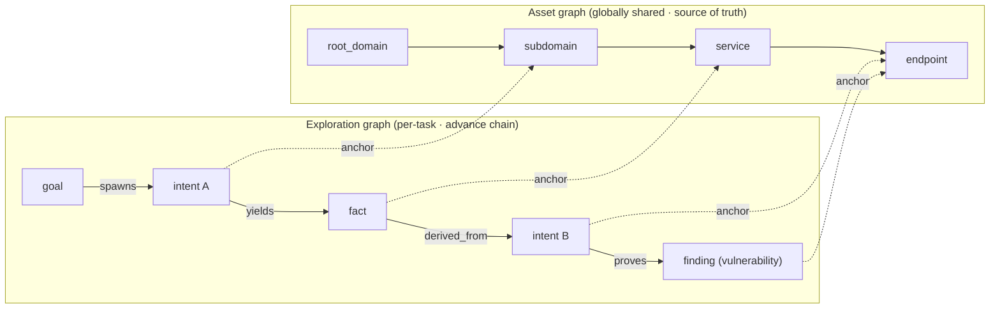

[Documentation](README.md) / Architecture

# Architecture

A Go monolith (Next.js UI embedded) plus PostgreSQL. Agent capabilities come from the [`norma`](https://github.com/Autumn-27/norma) SDK (`agentcore` / `tool` / `permission` / `harness` / `transcript` / `skill` / `llm`). At its core is the dual-graph design, plus process-level information exchange between workers and the planner's multi-round shared todolist.

| Layer | Responsibility |
| --- | --- |
| [Frontend](../web/src/) | Next.js static export embedded via `go:embed`; tasks, assets, exploration and coverage graphs, traffic, processes, workflows, human-in-the-loop chat |
| [Server](../server/) | `net/http` routing, JWT auth, SSE; `Manager` owns tasks, engines and DB stores |
| [Engine](../server/engine.go) | One `plannerLoop` + N worker goroutines per task; intent claiming, timeout/pause/drain |
| [Agent](../agent/) | goals / planner / worker / mainagent / pentest / auto / ctf; `ToolSet` exposes the dual graphs as tools |
| [Database](../db/) | PostgreSQL persistence (pgx); embedded schema and numbered migrations applied at startup |
| [Traffic](../traffic/) · [Interception](../intercept/) · [Evidence](../evidence/) | Recording MITM proxy, approval gate, and immutable evidence snapshots |
| [Scan jobs](../server/scan_jobs.go) · [Workflows](../server/workflows.go) | Allowlisted background execution, caching, concurrency limits, and ordered scan steps |

## Dual-graph architecture

The **asset graph** is shared across tasks: one source of truth for `root_domain / subdomain / ip / service / app / endpoint`, owned by companies. Parent-child relationships and deduplication keys are computed by the program; agents only submit raw observations. The **exploration graph** is per task: `goal / intent / fact / finding / hint` nodes joined by `spawns / derived_from / yields / proves` into a lineage chain. **Anchors** (`exploration_anchors(node_id, asset_id)`) tie intents, facts and findings to concrete assets — which assets a direction touched, which intents tested a given asset — and also power asset test coverage.

The planner reads the exploration graph, judges goals, and dispatches intents only when there is an uncovered direction. A worker claims one intent, executes it, writes assets/facts/findings back into both graphs, then stops.

## The engine loop

The engine is event-driven: changes in the graph wake the planner, workers record observations, and new observations can trigger another round. The graph and activity records give reviewers a traceable history.

## Design choices

- **An explicit gate.** The gated tool list and the paths outside it are documented in the [security model](security-model.md).
- **Evidence over adjectives.** `verified` comes from captured bytes and verbatim quotes, not from a confident sentence.
- **Argument validation.** Background jobs use a fixed executable allowlist and pass arguments without a shell.
- **Operator-triggered side effects.** Retests and workflows start when a human starts them.
- **One binary, one database.** The UI is embedded; PostgreSQL is the only service you must run.
- **AGPL-3.0 throughout.** Improvements stay available to the people running it.

---

[Toolkit](toolkit.md) · [Security model](security-model.md) · [Development](operations.md#development)
