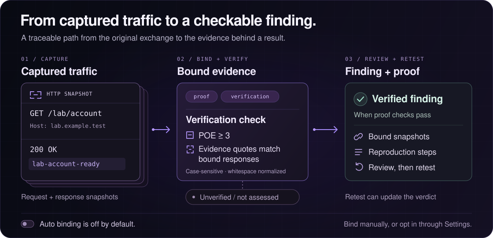

[Documentation](README.md) / Security model

# Security model

Understand the execution paths before starting an assessment. Configure rules in **Interception Rules**, inspect decisions in **Approval Records**, and use network controls for a hard target boundary.

## Execution boundaries

Task scope supplies assessment context and coverage guidance. Use network controls for an enforced target boundary. Review approval records for individual decisions and treat the approval gate as a control with a defined scope.

The platform separates recorded evidence, protected credentials, and execution records. Stored evidence headers are encrypted. Captured response bodies are stored as files, so protect the runtime and backup directories.

## Approval records

Review **Approval Records** to see the operation, the actor who decided, and the execution result when linked. A settled approval records the decision source as human, rule, model, or system.

## Evidence and verification

Findings can bind captured request/response snapshots as `baseline`, `proof`, `verification`, or `supporting` evidence. Initial verification requires a declared proof level of at least 3 and at least one qualifying quote. Each qualifying quote must occur, case-sensitively after whitespace normalization, in a bound `proof` or `verification` response body. Baseline and supporting traffic cannot satisfy this check. Gzip and deflate bodies are decoded before matching; normalized quotes shorter than 8 Unicode characters are ignored. The verifier reads at most 4 MiB per body. Unreadable evidence returns `not_assessed`; binary or truncated bodies cannot establish a missing quote.

A completed retest with a `reproduced` or `fixed` verdict can independently upgrade an unverified finding. A verified state records evidence assessment; review the report and reproduction steps before acting on a result.

Read the [traffic evidence reference](vulnerability-traffic-evidence.md) for storage, versioning, and export behavior.

## Authentication and storage

Report vulnerabilities privately through GitHub Security Advisories; see [SECURITY.md](../SECURITY.md).

- **Secrets at rest**: AES-256-GCM with `secret.key` in the configured key directory (or `SUPERARTEX_SECRET_KEY`). SuperArtex refuses to start when encrypted data exists and no usable key is available.
- **First-run claim**: `/setup` requires a one-time token printed at startup; the UI binds to `127.0.0.1` by default.
- **Login protection**: 10 attempts per minute per client IP, with trusted-proxy attribution.
- **Untrusted tool output**: framed as data for every agent by default (prompt-injection boundary).
- **Recording proxy**: generates its own CA; Bash tool calls carry the proxy URL and CA so HTTPS stays verifiable instead of skipping certificate checks.

See the [execution boundaries](#execution-boundaries) when reviewing controls and stored records.

For native builds, the default key directory is beside the binary. Compose sets `SUPERARTEX_JWT_KEY_DIR=/app/keys` and persists it at `./keys` on the host. Back up the actual key directory as well as the database and evidence bodies; see [operations](operations.md#back-up-the-complete-instance).

---

[Usage guide](usage.md) · [Configuration](configuration.md) · [Security policy](../SECURITY.md)
