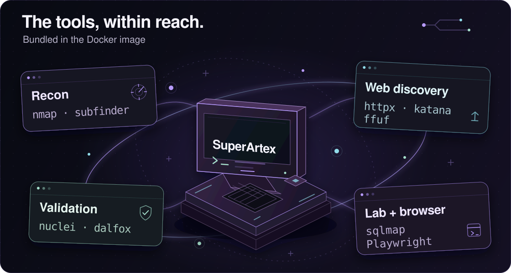

[Documentation](README.md) / Toolkit

# Toolkit

## Bundled capabilities

SuperArtex includes a skills inventory, a background runner, and interfaces for reviewing tool execution and workflow history. The platform records job status and execution results in the workspace.

## Platform

- **LLM profiles with failover**: Anthropic, OpenAI, OpenAI-compatible relays and keyless Ollama; multiple profiles per task with automatic failover.
- **Token accounting**: per-task and per-session usage, cache reads/writes, and an LLM record view for every call.
- **Notifications**: 8 channels — email, generic webhook, DingTalk, Feishu, WeCom, Telegram, Discord and Slack — realtime or digest, with severity filtering.
- **MCP servers, skills and a workspace**: extend the agent with remote tools, reusable playbooks and files.
- **Asset sync**: pull assets from a [ScopeSentry](https://github.com/Autumn-27/ScopeSentry) instance by project or task, merged by company scope into the asset graph.
- **Single binary**: the Next.js UI is embedded with `go:embed`; PostgreSQL is the only external dependency.

---

[Review existing results →](usage.md) · [Configuration](configuration.md) · [Security model](security-model.md)
